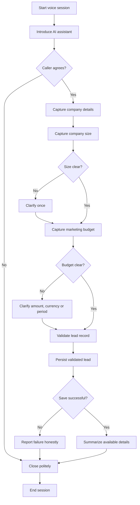

# Product Requirements Document (PRD)
# Autonomous Inbound Voice Agent for Lead Qualification

**Project:** Autonomous Voice Agent Setup  
**Version:** 1.0  
**Status:** Ready for Implementation  
**Category:** Voice AI, Agentic Workflows, Lead Qualification, Conversational AI  
**Primary Constraint:** ₹0 implementation and demonstration cost  
**Target User:** Digital agency prospective clients  
**Primary Deliverables:** Working voice agent, architecture documentation, flowchart, validated lead records, and raw demonstration recording

---

# 1. Executive Summary

## 1.1 Product Overview

The Autonomous Inbound Voice Agent is a lightweight AI-powered Sales Development Representative (SDR) that conducts short voice conversations with prospective clients of a digital marketing agency.

The agent answers an incoming browser-based voice session, introduces itself as an AI assistant, asks a small number of qualification questions, extracts relevant information, validates the collected data, and ends the conversation professionally.

The system must demonstrate a complete working interaction rather than merely displaying a chatbot interface.

For the initial version, the product will use a browser microphone, speech recognition, speech synthesis, an LLM API with an accessible free quota, and a deterministic conversation manager.

The initial version simulates an inbound call inside a browser. Public telephone-number integration is explicitly outside the mandatory MVP scope.

## 1.2 Problem Statement

Digital agencies receive enquiries from prospective clients but may not have the resources to respond immediately to every lead.

Manual lead qualification consumes time that sales representatives could spend evaluating promising prospects and following up with qualified businesses.

A voice agent can automate the initial information-gathering process by asking consistent questions, identifying incomplete information, and generating a structured lead record.

The system must balance natural conversation with predictable behaviour. An LLM alone cannot be trusted to maintain state, follow a fixed qualification sequence, or produce valid structured output on every turn.

Therefore, the product will combine an LLM with explicit state management, validation rules, and controlled conversation transitions.

## 1.3 Product Goals

1. Build a functional voice agent that can hold a short, live voice conversation.
2. Capture company information, company size, and approximate marketing budget.
3. Convert spoken responses into validated, structured lead data.
4. Maintain conversation state across multiple turns.
5. Handle interruptions, ambiguous answers, silence, off-topic questions, and early exits.
6. Enforce a strict JSON output contract.
7. Demonstrate successful execution using an unedited recording.
8. Use only free software, local execution, or legitimately available free API quotas and trial credits.
9. Produce architecture documentation and a plain-English flowchart that accurately represent the implementation.

## 1.4 Non-Goals

The MVP will not include:

- Paid telephony or a paid phone number.
- Autonomous outbound calling.
- Real email or SMS campaigns.
- CRM integrations with paid services.
- Appointment booking.
- Payment collection.
- Autonomous sales negotiation.
- Voice cloning or impersonation.
- Training a custom speech recognition or language model.
- Production-scale concurrent call handling.
- Complex multi-agent orchestration.
- Automated lead scoring based on unsupported business assumptions.

These features may be considered in a future version but must not delay the working demonstration.

---

# 2. Target Users and User Stories

## 2.1 Primary User: Prospective Client

A prospective client wants to enquire about digital marketing services without filling out a lengthy form.

The agent should make the conversation short, clear, and respectful.

### User stories

- As a caller, I want to hear a clear introduction so I understand who is speaking.
- As a caller, I want to answer questions naturally rather than fill out a form.
- As a caller, I want the agent to understand approximate numbers and ordinary spoken language.
- As a caller, I want to correct an answer without restarting the conversation.
- As a caller, I want to ask a question without the agent losing track of the conversation.
- As a caller, I want to stop the conversation at any time.
- As a caller, I want the agent to avoid inventing information about my company or its services.

## 2.2 Secondary User: Agency Sales Team

The sales team needs a consistent summary of each prospective lead.

### User stories

- As a sales representative, I want company size and marketing budget in structured fields.
- As a sales representative, I want unknown fields marked explicitly instead of fabricated.
- As a sales representative, I want to distinguish a fully qualified lead from a partially completed interaction.
- As a sales representative, I want to review the conversation transcript and its final data record.
- As a sales representative, I want to see whether the session completed successfully.

## 2.3 Evaluator

The evaluator needs evidence that the implementation actually works.

The evaluator should be able to observe:

- The agent greeting the caller.
- Live speech recognition.
- Relevant follow-up questions.
- Successful capture of lead data.
- Correct handling of at least one edge case.
- A valid JSON record.
- A graceful call ending.

---

# 3. Scope and Priorities

## 3.1 Priority Definitions

- **P0 — Mandatory:** Required for a successful MVP demonstration.
- **P1 — Important:** Improves reliability and evaluation quality.
- **P2 — Optional:** Additional capabilities that must not delay P0 requirements.

## 3.2 Feature Requirements

| ID | Feature | Priority |
|---|---|---|
| FR-001 | Start and end voice sessions | P0 |
| FR-002 | AI greeting and disclosure | P0 |
| FR-003 | Live speech recognition | P0 |
| FR-004 | Natural-language response generation | P0 |
| FR-005 | Company information extraction | P0 |
| FR-006 | Company size extraction | P0 |
| FR-007 | Marketing budget extraction | P0 |
| FR-008 | Deterministic conversation state machine | P0 |
| FR-009 | Strict JSON validation | P0 |
| FR-010 | Transcript display | P0 |
| FR-011 | Final lead summary | P0 |
| FR-012 | Graceful closing | P0 |
| FR-013 | Missing-field handling | P0 |
| FR-014 | Error and timeout handling | P0 |
| FR-015 | Interruption handling | P1 |
| FR-016 | Off-topic question handling | P1 |
| FR-017 | Correction of previously supplied data | P1 |
| FR-018 | Local persistence of completed records | P1 |
| FR-019 | Test scenario reporting | P1 |
| FR-020 | Browser compatibility fallback | P1 |
| FR-021 | CRM integration | P2 |
| FR-022 | Actual telephone integration | P2 |
| FR-023 | Human handoff integration | P2 |

---

# 4. Technology Stack

The stack must prioritize reliability, ease of demonstration, and zero expenditure.

## 4.1 Frontend

**Framework:** Next.js with React and TypeScript  
**Styling:** Tailwind CSS  
**Interface components:** Native controls or lightweight free UI components  
**Speech recognition:** Browser Web Speech API where supported  
**Speech synthesis:** Browser SpeechSynthesis API

Responsibilities:

- Request microphone permission.
- Start and stop voice sessions.
- Display live transcript entries.
- Display the current conversation state.
- Present the agent's spoken response.
- Show extracted lead fields.
- Display loading and error states.
- Provide a fallback text interaction when speech recognition is unavailable.

Speech recognition and speech synthesis are separate browser capabilities. Browser support, recognition behaviour, available voices, and processing location can vary.

The interface must not assume that recognition is universally available or that all recognition occurs locally.

## 4.2 Backend

**Framework:** Python FastAPI  
**Validation:** Pydantic  
**HTTP client:** HTTPX or another free standard HTTP client  
**Testing:** Pytest  
**Data persistence:** SQLite

Responsibilities:

- Receive recognized caller text.
- Manage session state.
- Call the LLM provider.
- Validate model responses.
- Apply deterministic business rules.
- Store completed lead records.
- Expose session and lead APIs.
- Return safe fallback responses when an upstream request fails.

SQLite is sufficient for this single-instance demonstration. PostgreSQL, Redis, Celery, and a distributed event architecture are unnecessary for the MVP.

## 4.3 LLM

**Preferred provider:** Groq API, subject to available free quota and current model availability.

The LLM will be used for:

- Classifying caller intent.
- Extracting structured facts.
- Interpreting natural-language numbers.
- Detecting ambiguity.
- Generating short spoken responses.
- Suggesting the next conversational response within the application's rules.

The model must not independently determine whether a session has been saved or whether a human transfer has occurred.

Model availability, structured-output support, rate limits, and free usage limits must be verified before implementation.

## 4.4 Cost Policy

The project must remain within a total external spending budget of ₹0.

Rules:

1. Do not purchase API credits.
2. Do not enter a paid subscription to unlock features.
3. Do not use paid telephony.
4. Do not assume a free trial is unlimited.
5. Do not rely on a trial that requires payment to continue.
6. Keep API keys in environment variables.
7. Use local development and testing wherever possible.
8. Implement clear handling for rate limits and quota exhaustion.
9. Verify the terms of any hosted deployment before using it.
10. Stop external API requests when the free quota is exhausted.

If the LLM quota is unavailable, the application must offer a deterministic fallback or report that AI inference is unavailable. It must not silently imply that the LLM is operating normally.

The browser prototype must remain usable through its text interface even if voice recognition or external model inference fails.

---

# 5. System Architecture

## 5.1 High-Level Architecture

The system consists of six logical components.

### Component A: Voice Interface

The browser captures speech, converts it into text, and presents spoken responses.

It owns microphone permissions, voice-session controls, transcript rendering, and speech playback.

### Component B: Session Manager

The backend creates and tracks each conversation session.

Each session contains:

- Session identifier.
- Current state.
- Lead fields.
- Conversation transcript.
- Number of clarification attempts.
- Session start and end timestamps.
- Final qualification status.
- Last processed turn identifier.

### Component C: Conversation Manager

The conversation manager determines which question should be asked next.

It enforces the qualification order, prevents repeated questions where possible, applies retry limits, and handles caller requests to stop.

The LLM can interpret caller language but cannot bypass these deterministic rules.

### Component D: LLM Extraction Service

The extraction service receives the current caller utterance and relevant session context.

It returns structured candidate facts, an intent classification, and a proposed response.

All model output is untrusted until validated.

### Component E: Validation and Policy Layer

This layer verifies:

- JSON structure.
- Allowed enum values.
- Field types.
- Numeric ranges.
- Currency and budget-period consistency.
- Missing fields.
- Session-state transitions.
- Call-ending conditions.

It decides which model-proposed values may be committed to the lead record.

### Component F: Lead Repository

The repository stores completed or partially completed lead records in SQLite.

A record is saved only after server-side validation.

The API response must distinguish a successfully persisted record from an unsaved candidate record.

## 5.2 Data Flow

1. The caller starts a voice session.
2. The browser obtains microphone permission.
3. The backend creates a session.
4. The agent generates a greeting.
5. The browser speaks the greeting.
6. The caller answers.
7. Speech recognition produces a transcript.
8. The transcript is submitted to the backend.
9. The backend retrieves the session state.
10. The LLM extracts facts and classifies the utterance.
11. The validator checks the extraction.
12. The session manager updates valid fields.
13. The conversation manager selects the next action.
14. The response is returned to the browser.
15. The browser speaks the response.
16. The process repeats until the call ends.
17. The backend validates and persists the final record.
18. The UI displays the saved lead summary.

## 5.3 Trust Boundaries

The browser, caller transcript, LLM response, and external API are all potentially unreliable inputs.

The backend is the authoritative source for session state and lead persistence.

The browser must not be allowed to mark an unvalidated lead as qualified by changing client-side state.

The LLM must not directly write to the database.

---

# 6. Conversation Design

## 6.1 Default Conversation

The agent should ask three primary qualification questions.

**Opening**

"Hello! I'm Ava, an AI assistant with the digital marketing agency. I can ask you a few quick questions to understand your business needs. Is now a good time?"

**Question 1 — Company**

"Could you briefly tell me your company name and what your business does?"

**Question 2 — Company size**

"Thanks! Approximately how many employees or team members does your company have?"

**Question 3 — Marketing budget**

"Understood. Approximately how much do you spend on marketing each month?"

**Closing**

"Thank you for sharing those details. I've recorded the information available from our conversation. Our team can review your enquiry and follow up if that option is configured. Have a great day!"

The final message must reflect the actual application outcome. If persistence fails, the agent must not claim that the information has been saved.

## 6.2 Conversation Rules

- Ask one primary question at a time.
- Keep spoken responses concise.
- Avoid unnecessary explanations.
- Never ask again for a field that has already been supplied clearly.
- Confirm uncertain values only when clarification materially affects the record.
- Allow callers to correct earlier answers.
- Respect requests to stop.
- Do not pressure callers to disclose financial information.
- Never invent agency pricing, service capabilities, or guarantees.
- Do not claim to schedule a meeting or notify a representative unless that action exists and succeeds.

## 6.3 Company Information

Capture:

- Company name.
- Business type or industry.
- Optional short business description.

If the caller does not want to share a company name, continue where possible.

Company name and business type may be collected in the same utterance, but the interface should not ask a compound question that becomes confusing when spoken aloud.

## 6.4 Company Size

Normalize natural-language answers into an integer only when the intended count is clear.

Examples:

- "We have twenty-five employees" → `25`
- "About fifty people" → `50`
- "It's just me" → `1`
- "We're a small company" → `null`, followed by a clarification if necessary.

Preserve the fact that an estimate was approximate in an optional metadata field or transcript.

Do not confuse number of customers, offices, or years in business with employee count.

## 6.5 Marketing Budget

Capture the amount, currency, and period separately.

Examples:

- "₹50,000 per month" → amount `50000`, currency `INR`, period `monthly`.
- "About two thousand dollars a month" → amount `2000`, currency `USD`, period `monthly`.
- "We spend fifty thousand" → amount may remain `null` until the currency and intended scale are sufficiently clear.
- "Around five lakhs annually" → amount `500000`, currency `INR` only if the conversational context clearly establishes rupees; period `yearly`.

Do not infer a currency from location alone when the caller's meaning remains ambiguous.

Do not automatically convert yearly budgets to monthly values unless the application explicitly retains both the original amount and the normalized amount.

---

# 7. Conversation State Machine

The conversation manager must implement the following states.

## 7.1 States

### `GREETING`

Introduce the assistant and explain the purpose of the conversation.

Transition to `ASK_COMPANY` when the caller agrees to continue.

Transition to `CLOSING` if the caller declines.

### `ASK_COMPANY`

Capture company name and business type.

Transition to `ASK_SIZE` after collecting the available company information or recording that the caller declined to provide it.

### `ASK_SIZE`

Capture employee count.

If ambiguous, transition to `CLARIFY_SIZE`.

Otherwise, transition to `ASK_BUDGET`.

### `CLARIFY_SIZE`

Ask a concise clarification.

After the permitted retry, accept an unknown value and continue.

### `ASK_BUDGET`

Capture marketing budget amount, currency, and period.

Transition to `CLARIFY_BUDGET` if the answer is ambiguous.

Otherwise, transition to `VALIDATE_LEAD`.

### `CLARIFY_BUDGET`

Ask for the missing amount interpretation, currency, or period.

Do not ask for details already established by the caller.

### `VALIDATE_LEAD`

Validate the collected record.

If required qualification fields are available, mark it `qualified`.

If one or more required fields are unavailable, mark it `partially_qualified` unless a business rule explicitly disqualifies the lead.

Transition to `SAVE_LEAD`.

### `SAVE_LEAD`

Persist the final record.

If persistence succeeds, transition to `CLOSING`.

If persistence fails, provide a truthful fallback and preserve the session transcript for a retry where possible.

### `CLOSING`

Thank the caller and end the session.

### `ENDED`

Stop microphone capture and speech playback, finalize session metadata, and reject additional conversation turns for the ended session unless a new session is explicitly created.

## 7.2 Global Transitions

The following conditions apply from every active state:

- `GOODBYE`: finalize available information and close.
- `HUMAN_REQUEST`: acknowledge the request and explain the available next step.
- `OFF_TOPIC`: respond briefly or redirect.
- `UNCLEAR`: ask for clarification, subject to retry limits.
- `API_FAILURE`: use a safe fallback response.
- `SESSION_TIMEOUT`: finalize the available record if appropriate and close.
- `USER_CORRECTION`: update the relevant field and recalculate missing fields.

The caller's explicit request to stop takes precedence over collecting all qualification fields.

## 7.3 Flowchart

The implementation documentation must include this flowchart.



This diagram is the standard qualification path. Global transitions for interruptions, off-topic questions, human requests, and early exits must also be implemented and documented.

---

# 8. LLM Prompt Architecture

## 8.1 Design Principle

Use the LLM for interpretation and language generation, not unrestricted workflow control.

The backend supplies:

- Current state.
- Previously validated lead data.
- Current caller utterance.
- Allowed next states.
- Missing fields.
- Allowed intents.
- JSON schema.

The LLM returns a structured candidate response.

The backend validates the candidate and independently decides whether the proposed transition is allowed.

## 8.2 System Prompt

The system prompt must establish the following requirements.

**Role:** You are Ava, a professional AI SDR for a digital marketing agency.

**Goal:** Qualify an inbound enquiry by collecting company information, company size, and approximate marketing budget.

**Behaviour:**

1. Identify yourself as an AI assistant.
2. Ask one question at a time.
3. Remain polite and concise.
4. Respect interruptions and corrections.
5. Ask clarification questions when data is ambiguous.
6. Preserve previously validated facts.
7. Never invent a company name, employee count, budget, currency, or business capability.
8. Handle unrelated questions briefly and redirect to the task.
9. Respect the caller's choice to stop.
10. Never claim an action succeeded unless the application confirms it.

**Reasoning:** Internally determine intent, extract explicit facts, detect ambiguity, and identify missing information. Do not reveal private chain-of-thought.

**Output:** Return exactly one JSON object matching the required schema. No Markdown fences or explanatory text outside the object.

## 8.3 Structured Output Requirements

Use the selected model's supported structured-output or JSON mode where available.

Validate every response with Pydantic.

If parsing fails:

1. Reject the malformed response.
2. Retry with a bounded repair attempt.
3. If validation still fails, return a deterministic fallback.
4. Do not commit unvalidated values.
5. Record the failure in the session's operational metadata.

Never allow repeated retries to create an infinite request loop.

---

# 9. Canonical Lead JSON Schema

## 9.1 Example Record

```json
{
  "session_id": "session_example_001",
  "intent": "lead_qualification",
  "conversation_state": "ASK_BUDGET",
  "response": "Approximately how much do you spend on marketing each month?",
  "lead": {
    "company_name": "Acme Digital",
    "business_type": "E-commerce",
    "company_size": 25,
    "marketing_budget": null,
    "budget_currency": null,
    "budget_period": "unknown",
    "contact_name": null,
    "contact_email": null
  },
  "missing_fields": [
    "marketing_budget",
    "budget_currency",
    "budget_period"
  ],
  "qualification_status": "in_progress",
  "should_end_call": false
}
```

This represents an in-progress turn. Final persisted lead records must use a separate persistence model so that a conversational response cannot accidentally overwrite final lead metadata.

## 9.2 Field Definitions

| Field | Type | Rules |
|---|---|---|
| `session_id` | String | Generated by the backend |
| `intent` | Enum | Only documented intent values |
| `conversation_state` | Enum | Only allowed state names |
| `response` | String | Short text suitable for speech |
| `lead.company_name` | String or null | Never fabricate |
| `lead.business_type` | String or null | Explicitly stated or confirmed |
| `lead.company_size` | Integer or null | Non-negative, subject to reasonable limits |
| `lead.marketing_budget` | Number or null | Non-negative amount |
| `lead.budget_currency` | String or null | Valid currency code |
| `lead.budget_period` | Enum | Monthly, quarterly, yearly, one-time, unknown |
| `lead.contact_name` | String or null | Optional |
| `lead.contact_email` | String or null | Optional; validate format if supplied |
| `missing_fields` | String array | Recomputed by backend |
| `qualification_status` | Enum | In progress, qualified, partially qualified, disqualified |
| `should_end_call` | Boolean | Validated against workflow rules |

## 9.3 Enumerations

`intent`:

- `lead_qualification`
- `off_topic`
- `human_request`
- `goodbye`
- `unclear`

`conversation_state`:

- `GREETING`
- `ASK_COMPANY`
- `ASK_SIZE`
- `CLARIFY_SIZE`
- `ASK_BUDGET`
- `CLARIFY_BUDGET`
- `VALIDATE_LEAD`
- `SAVE_LEAD`
- `CLOSING`
- `ENDED`

`qualification_status`:

- `in_progress`
- `qualified`
- `partially_qualified`
- `disqualified`

## 9.4 Validation Rules

- Unknown values must be represented as `null`.
- `missing_fields` must be calculated by the backend.
- The backend owns the actual conversation state.
- A model cannot mark a lead `qualified` if mandatory fields are missing.
- A caller's request to stop must not be overridden by the LLM.
- `should_end_call` is accepted only when consistent with the workflow.
- JSON must not contain additional undocumented keys unless the schema is deliberately extended.
- Persisted records must include a timestamp and final status.
- Duplicate turn submissions must not duplicate persisted leads.

---

# 10. Functional Requirements

## FR-001: Start Session

The interface must expose a Start Call control.

When activated:

1. Verify browser capability.
2. Request microphone permission.
3. Create a new backend session.
4. Initialize the conversation state.
5. Generate and play the greeting.
6. Display a clear listening status.

If permission is denied, explain how to enable it and provide the text-based fallback.

## FR-002: Capture Speech

The browser must convert the caller's utterance into text when supported.

The interface must distinguish:

- Listening.
- Processing.
- Speaking.
- Idle.
- Error.
- Ended.

The system must not submit the same recognized utterance multiple times because of duplicate final recognition events.

## FR-003: Generate Agent Response

The frontend sends the recognized text and session identifier to the backend.

The backend processes the turn, validates candidate data, and returns the response text and updated session state.

The browser then speaks the response.

## FR-004: Capture Lead Data

The system must support company name, business type, company size, marketing budget, currency, and budget period.

Optional contact details must not be mandatory for the basic qualification flow.

## FR-005: Display Transcript

Show caller utterances and agent responses in chronological order.

Clearly distinguish caller speech from agent speech.

Display errors and clarification prompts in the transcript where relevant.

## FR-006: Display Lead Summary

The interface must show:

- Company name.
- Business type.
- Company size.
- Marketing budget.
- Currency.
- Budget period.
- Missing fields.
- Qualification status.
- Session completion status.

Unknown values must display as "Not provided" rather than misleading zero values.

## FR-007: End Session

The user must be able to end the session at any time.

Ending the session must:

1. Stop speech recognition.
2. Cancel agent speech playback.
3. Prevent new turns from being processed.
4. Finalize available session information.
5. Persist the lead when appropriate.
6. Display the actual persistence result.

## FR-008: Persist Lead

The backend must save validated records to SQLite.

Each record must contain:

- Lead identifier.
- Session identifier.
- Creation timestamp.
- Last updated timestamp.
- Lead fields.
- Qualification status.
- Session completion status.

A completed session should not create duplicate records on retries.

## FR-009: Error Handling

Provide controlled handling for:

- Missing API key.
- Provider rate limit.
- Provider timeout.
- Malformed JSON.
- Schema validation failure.
- Microphone permission denial.
- Unsupported speech recognition.
- Empty transcript.
- Database write failure.
- Duplicate requests.
- Network disconnection.

Every error must have a safe, understandable user-facing response.

---

# 11. API Specification

All endpoints are internal application APIs. They must not expose the LLM provider's API key to the browser.

## 11.1 Create Session

`POST /api/sessions`

Response:

```json
{
  "session_id": "generated-id",
  "state": "GREETING",
  "status": "active"
}
```

## 11.2 Process Turn

`POST /api/sessions/{session_id}/turns`

Request:

```json
{
  "turn_id": "turn-001",
  "transcript": "We have 25 employees.",
  "timestamp": "2026-10-13T00:00:00Z"
}
```

Response:

```json
{
  "session_id": "generated-id",
  "turn_id": "turn-001",
  "response": "Thanks. Approximately how much do you spend on marketing each month?",
  "state": "ASK_BUDGET",
  "lead": {
    "company_name": "Acme Digital",
    "business_type": "E-commerce",
    "company_size": 25,
    "marketing_budget": null,
    "budget_currency": null,
    "budget_period": "unknown",
    "contact_name": null,
    "contact_email": null
  },
  "qualification_status": "in_progress",
  "should_end_call": false
}
```

The server must verify that the session is active and that the turn has not already been processed.

## 11.3 Get Session

`GET /api/sessions/{session_id}`

Returns the current state, available lead data, transcript metadata, and session status.

## 11.4 End Session

`POST /api/sessions/{session_id}/end`

The server finalizes the session and returns the actual completion and persistence outcome.

## 11.5 List Leads

`GET /api/leads`

Returns saved leads in reverse chronological order for the demonstration dashboard.

## 11.6 Get Lead

`GET /api/leads/{lead_id}`

Returns a single persisted lead record.

## 11.7 Health Check

`GET /health`

Returns service health and a minimal status indication. It must not expose secrets or environment variables.

---

# 12. User Interface Requirements

## 12.1 Design Principles

Use a clean, minimal, professional dashboard.

Avoid elaborate animations and decorative visualizations that do not help demonstrate functionality.

The primary objective is to make the voice interaction and captured data immediately understandable.

## 12.2 Main Screen

The main screen should contain:

**Header**
- Product name.
- Agent status.
- Backend connection status.

**Voice control panel**
- Start Call.
- End Call.
- Mute or speech controls where supported.
- Current interaction status.

**Conversation panel**
- Live transcript.
- Agent responses.
- Caller messages.
- Error messages.

**Lead panel**
- Company details.
- Team size.
- Marketing budget.
- Currency and period.
- Missing information.
- Qualification status.

**Session summary**
- Session identifier.
- Start and end time.
- Whether the record was saved.
- Any processing errors.

## 12.3 Interaction States

The interface must support:

- Ready to start.
- Requesting microphone permission.
- Listening to caller.
- Processing caller response.
- Speaking agent response.
- Waiting for clarification.
- Session completed.
- Session interrupted.
- API unavailable.
- Recognition unsupported.
- Persistence failure.

Buttons must reflect the current state. Starting a second concurrent session from the same interface must not be possible in the MVP.

---

# 13. Interruption and Edge-Case Handling

## 13.1 Barge-In

If the caller speaks while the agent is speaking:

1. Detect new speech where browser support permits.
2. Cancel current speech synthesis.
3. Preserve the active session.
4. Process the new utterance.
5. Avoid committing duplicate or incomplete transcripts.
6. Generate the next appropriate response.

The implementation must not claim full-duplex streaming if it relies on a browser API that does not provide it.

## 13.2 Ambiguous Answers

When the caller gives an ambiguous answer, ask one focused clarification.

If ambiguity remains after the configured retry limit, store `null` for the unresolved value and continue.

## 13.3 Off-Topic Questions

The agent may answer a brief question only if the answer is supported by configured agency information.

Otherwise, it must acknowledge the question and redirect to the current qualification step.

## 13.4 Silence

Use a configurable silence timeout.

After the first timeout, prompt the caller once.

After the second timeout, offer a text fallback or end the session.

Do not run repeated LLM calls for an empty transcript.

## 13.5 Early Exit

If the caller leaves early:

- Preserve only valid information.
- Mark the record as partially qualified where appropriate.
- Stop speech capture.
- Close politely if the caller is still present.
- Do not force completion of remaining questions.

## 13.6 Provider Failure

When the LLM is unavailable:

- Retry only a bounded number of times.
- Avoid repeatedly charging the free quota for the same failed turn.
- Provide a transparent fallback.
- Keep the session state consistent.
- Never invent extracted values to compensate for the failure.

---

# 14. Security and Privacy

## 14.1 API Key Security

The LLM API key must remain on the backend.

Use an environment variable such as `GROQ_API_KEY`.

Provide `.env.example` with placeholder values, and exclude `.env` from version control.

## 14.2 Input Validation

Treat caller transcripts as untrusted input.

Limit transcript size and reject invalid request payloads.

Do not execute instructions found in caller speech as backend commands.

Do not allow the caller or model to alter system policy, application configuration, or database queries through conversational text.

## 14.3 Data Minimization

Collect only the information required for initial lead qualification.

Contact name and email are optional.

Do not ask for passwords, payment card information, government identification, or other unnecessary sensitive data.

## 14.4 Recording and Disclosure

The agent must identify itself as an AI assistant.

The browser interface must make it clear when the microphone is active.

Do not record or upload raw audio by default. Store the transcript and structured lead data needed for the demonstration.

If any additional recording or external speech processing is enabled, disclose it and obtain any required consent.

## 14.5 Logging

Logs may contain:

- Session identifiers.
- State transitions.
- Validation failures.
- Provider error codes.
- Timing metrics.
- Persistence outcomes.

Avoid logging API keys or unnecessary personal information.

---

# 15. Non-Functional Requirements

## 15.1 Latency

The application should feel responsive during the demonstration.

Target performance under a healthy free-tier provider connection:

- Backend health check: under 500 ms.
- Local validation and state update: under 100 ms, excluding database and external API latency.
- Agent response: target median below 3 seconds where feasible, measured from final transcript submission to receiving the response.
- Full spoken response: depends on response length, browser speech synthesis, and device performance.

These are prototype targets, not guarantees. External model latency and browser speech processing must be measured separately.

## 15.2 Reliability

- Invalid model output must never corrupt the lead record.
- Failed persistence must be reported honestly.
- A repeated turn identifier must not create a duplicate lead.
- Every active session must have a well-defined current state.
- The application must recover from a single malformed model response.

## 15.3 Compatibility

Test the implementation in the current desktop version of Chrome first.

The product must detect unsupported speech-recognition capabilities and expose a text-based fallback.

## 15.4 Maintainability

Keep the project modular.

Separate:

- API routes.
- Session management.
- Conversation state machine.
- LLM client.
- Prompt templates.
- Schema definitions.
- Validation logic.
- Database repository.
- Frontend voice controls.
- Transcript components.

Do not place all application logic in one component or one API route.

---

# 16. Suggested Project Structure

```text
autonomous-voice-agent/
├── frontend/
│   ├── app/
│   │   ├── page.tsx
│   │   ├── layout.tsx
│   │   └── api/
│   ├── components/
│   │   ├── VoiceControls.tsx
│   │   ├── TranscriptPanel.tsx
│   │   ├── LeadSummary.tsx
│   │   └── SessionStatus.tsx
│   ├── hooks/
│   │   └── useVoiceSession.ts
│   ├── lib/
│   │   ├── speech-recognition.ts
│   │   └── speech-synthesis.ts
│   └── package.json
├── backend/
│   ├── app/
│   │   ├── main.py
│   │   ├── api/
│   │   │   ├── sessions.py
│   │   │   └── leads.py
│   │   ├── services/
│   │   │   ├── llm_client.py
│   │   │   ├── conversation_manager.py
│   │   │   ├── extraction_service.py
│   │   │   └── validation_service.py
│   │   ├── schemas/
│   │   │   ├── conversation.py
│   │   │   └── lead.py
│   │   ├── models/
│   │   │   └── session.py
│   │   ├── repositories/
│   │   │   └── lead_repository.py
│   │   └── prompts/
│   │       └── sdr_system_prompt.txt
│   ├── tests/
│   │   ├── test_state_machine.py
│   │   ├── test_extraction.py
│   │   ├── test_validation.py
│   │   └── test_api.py
│   ├── requirements.txt
│   └── .env.example
├── docs/
│   ├── ARCHITECTURE.md
│   ├── FLOWCHART.md
│   └── TEST_RESULTS.md
├── recordings/
│   └── README.md
├── .gitignore
├── README.md
└── PRD.md
```

This structure is a guideline. Do not create empty modules merely to match the tree; implement only what the chosen architecture requires.

---

# 17. Testing Strategy

## 17.1 Unit Tests

Test:

- State transitions.
- Budget parsing.
- Employee-count parsing.
- Currency and period handling.
- Missing-field calculation.
- Qualification status.
- JSON parsing.
- Pydantic validation.
- Retry limits.
- Early-exit handling.
- Duplicate turn handling.

## 17.2 Integration Tests

Test:

- Session creation.
- Processing a caller turn.
- Updating session state.
- Handling an invalid model response.
- Persisting a lead.
- Retrieving saved leads.
- Ending a session.
- Recovering from a simulated provider failure.

Use mocked LLM responses for deterministic automated tests so the test suite does not depend on API credits.

## 17.3 End-to-End Scenarios

### Scenario A: Successful Qualification

Caller says:

"We run an e-commerce company called Acme Digital, have 25 employees, and spend ₹50,000 a month on marketing."

Expected result:

- Company name: Acme Digital.
- Business type: E-commerce.
- Company size: 25.
- Marketing budget: 50000.
- Currency: INR.
- Period: monthly.
- Qualification status: qualified, if all configured mandatory fields are satisfied.
- Record persisted successfully.

### Scenario B: Ambiguous Budget

Caller says:

"We spend about fifty."

Expected result:

- Do not guess the scale or currency.
- Ask for clarification.
- Keep unresolved values null.
- Continue after the answer or retry limit.

### Scenario C: Caller Correction

Caller says:

"We have 25 employees. Actually, make that 40."

Expected result:

- Final company size: 40.
- Do not create a second lead.
- Preserve the transcript of both statements.

### Scenario D: Off-Topic Question

Caller asks:

"Can you tell me a joke?"

Expected result:

- Respond briefly or decline politely.
- Redirect to the pending qualification question.
- Preserve conversation state.

### Scenario E: Early Exit

Caller says:

"I need to go now."

Expected result:

- End the session.
- Preserve available data.
- Mark the record partially qualified if appropriate.
- Do not continue asking questions.

### Scenario F: Invalid LLM Output

The model returns malformed JSON.

Expected result:

- Validation fails.
- A bounded repair attempt occurs.
- A safe fallback is returned if necessary.
- No invalid lead data is persisted.

### Scenario G: Microphone Denied

The caller denies browser microphone permission.

Expected result:

- Show a clear error.
- Offer text interaction.
- Do not enter an infinite listening state.

### Scenario H: Provider Rate Limit

The LLM provider returns a rate-limit error.

Expected result:

- Avoid unbounded retries.
- Keep the session consistent.
- Inform the user that AI processing is temporarily unavailable.
- Do not fabricate a successful response.

## 17.4 Acceptance Thresholds

Before submission:

- All critical automated tests must pass.
- Every valid model output must pass schema validation.
- Invalid model output must be rejected.
- All mandatory lead fields must be extracted correctly in the agreed test fixtures.
- The live demo must successfully complete at least one real voice conversation.
- At least one edge case must be demonstrated.
- The final lead record must be visibly available.
- No paid service may be required to reproduce the demonstration within the documented free quota.

---

# 18. Evaluation Mapping

| Evaluation criterion | Implementation evidence |
|---|---|
| Prompt architecture | System prompt, canonical schema, validation tests |
| Prompt quality | Role-based instructions, concise responses, internal reasoning without chain-of-thought disclosure |
| Voice agent logic | State machine and edge-case flowchart |
| Voice execution | Raw recording of a live interaction |
| Tooling constraint | Documented free-tier setup and zero-cost operation |
| Lead qualification | Final structured lead record |
| Reliability | Automated tests and bounded failure handling |

---

# 19. Demonstration Plan

The demonstration should be short and unedited.

## 19.1 Recording Sequence

1. Open the running application.
2. Show that the backend is available.
3. Click Start Call.
4. Grant microphone access.
5. Let the agent introduce itself.
6. Answer the company question.
7. Answer the company-size question.
8. Answer the budget question.
9. Introduce one realistic edge case, such as an ambiguous budget or correction.
10. Let the agent resolve the ambiguity.
11. End the conversation.
12. Show the final lead summary.
13. Show the persisted JSON record or corresponding API response.

## 19.2 Recording Requirements

- Use a real microphone.
- Use live speech, not a prerecorded transcript.
- Do not replace failed interactions with edited footage.
- Keep the actual application visible.
- Ensure that the final record corresponds to the conversation.
- Do not expose API keys, private account details, or unrelated browser information.

The raw recording may be captured using a free screen recorder. A Loom free tier may be used only if its current limits are sufficient; local screen recording is an acceptable alternative.

---

# 20. Submission Deliverables

## Deliverable A: Architecture Document

Must include:

- Problem statement.
- Component architecture.
- Data flow.
- Conversation algorithm.
- Error-handling rules.
- Technology stack.
- Cost constraints.

## Deliverable B: Flowchart

Must include:

- Start session.
- Greeting.
- Qualification questions.
- Clarification.
- Off-topic handling.
- Early exit.
- Validation.
- Persistence.
- Closing.

## Deliverable C: Working Voice Demo

Must show:

- Live caller speech.
- Spoken agent responses.
- Successful qualification.
- Structured lead data.
- At least one edge case.

## Deliverable D: Source Code

Must include:

- Frontend and backend source.
- Environment-variable example.
- Setup instructions.
- Automated tests.
- Prompt template.
- Schema definitions.
- No committed secrets.

## Deliverable E: Test Results

Must document:

- Test scenario.
- Expected result.
- Actual result.
- Pass/fail status.
- Any known limitation.

## Deliverable F: Setup Guide

The README must explain how to install dependencies, configure the optional free API key, start the backend, start the frontend, run tests, and record the demonstration.

---

# 21. Implementation Phases

## Phase 1: Architecture and Core Backend

Objectives:

- Finalize data schema.
- Implement session creation and storage.
- Implement the deterministic state machine.
- Integrate the LLM provider.
- Implement schema validation and bounded retries.
- Test the API using mocked model responses.

**Exit criteria:** The complete qualification workflow works through text input and returns valid structured records.

## Phase 2: Voice Interface and Dashboard

Objectives:

- Implement microphone controls.
- Add browser speech recognition.
- Add speech synthesis.
- Connect the voice interface to the backend.
- Implement transcript and lead summary.
- Add error handling and text fallback.
- Test the full interaction in the target browser.

**Exit criteria:** A user can complete a voice-based qualification conversation and view the resulting lead record.

## Phase 3: Validation and Submission

Objectives:

- Run all automated tests.
- Test interruption and ambiguous-answer behaviour.
- Verify persistence and duplicate handling.
- Check free-tier availability and spending.
- Prepare architecture documentation and flowchart.
- Record the unedited demonstration.
- Verify the repository contains no secrets.

**Exit criteria:** All mandatory acceptance criteria are satisfied, and another developer can reproduce the demonstration from the README.

---

# 22. Definition of Done

The MVP is complete only when all of the following are true:

- [ ] The application starts locally using documented instructions.
- [ ] The user can start and end a voice session.
- [ ] The agent clearly identifies itself as an AI assistant.
- [ ] The agent asks the required qualification questions.
- [ ] Speech is converted into usable transcript text.
- [ ] Lead data is extracted into the defined schema.
- [ ] The conversation manager maintains state correctly.
- [ ] Missing and ambiguous values are handled without fabrication.
- [ ] At least one correction or interruption scenario works.
- [ ] Off-topic questions are handled appropriately.
- [ ] Invalid model output cannot corrupt the record.
- [ ] API failures produce safe, truthful fallback behaviour.
- [ ] Valid lead records are persisted and retrievable.
- [ ] The UI displays the actual persisted result.
- [ ] Automated tests pass.
- [ ] Architecture documentation is complete.
- [ ] The flowchart matches the implemented logic.
- [ ] The raw demonstration recording shows a genuine successful interaction.
- [ ] The implementation requires no payment to reproduce within its documented free-tier limits.

---

# 23. Future Enhancements

These are explicitly outside the initial MVP.

- Real inbound PSTN calling using a verified free trial.
- Integration with an agency CRM.
- Appointment scheduling.
- Configurable agency knowledge base.
- Multilingual qualification.
- Improved streaming speech recognition and barge-in.
- Multiple agency qualification profiles.
- Lead scoring based on explicit business rules.
- Analytics for conversation completion and qualification rates.
- Human handoff through a real configured integration.

Future features must preserve the core principles of validated structured output, deterministic state management, explicit consent, and transparent handling of errors.

---

# 24. Final Product Principle

The product is not successful merely because an LLM can speak.

It is successful when a caller can have a short, understandable conversation; the system correctly extracts the information supplied; the conversation remains under application control; the resulting record passes validation; and the complete interaction can be reproduced in a real demonstration.

**Build the smallest reliable system that proves this end to end.**