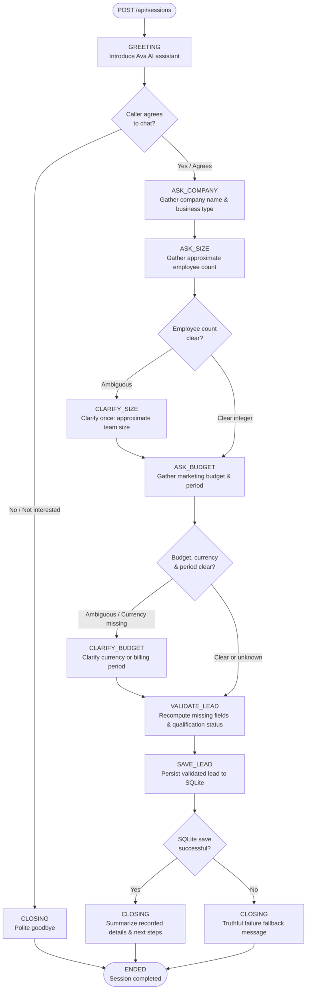
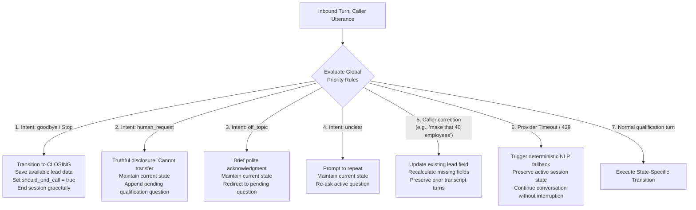

# State Machine Flowchart: Ava Inbound Voice Agent

This document visualizes the deterministic conversation state machine implemented in `backend/app/services/conversation_manager.py`.

---

## 1. Primary Qualification Flowchart



---

## 2. Global Transition Hierarchy

The following global transitions apply from **every active conversation state**:



---

## 3. Plain English State Definitions

| State | Purpose | Next Transition on Success | Edge Cases Handled |
|---|---|---|---|
| `GREETING` | Ava introduces herself as an AI SDR and requests permission to ask quick questions. | `ASK_COMPANY` (caller agrees) | If caller declines or says not now, transitions directly to polite `CLOSING` and `ENDED`. |
| `ASK_COMPANY` | Inquires about company name and industry/business type. | `ASK_SIZE` | If caller prefers not to disclose, continues without blocking. |
| `ASK_SIZE` | Inquires about approximate number of team members or employees. | `ASK_BUDGET` (if clear count) | If count is ambiguous ("a few people"), transitions to `CLARIFY_SIZE`. |
| `CLARIFY_SIZE` | Asks focused clarification for approximate team size. | `ASK_BUDGET` | Permitted retry: 1 attempt. If still ambiguous, accepts `null` and continues. |
| `ASK_BUDGET` | Inquires about monthly/annual marketing budget. | `VALIDATE_LEAD` (if budget, currency, and period are clear) | If amount is given without currency or period, transitions to `CLARIFY_BUDGET`. If caller declines, leaves `null` and continues. |
| `CLARIFY_BUDGET` | Asks focused clarification on missing currency or timeframe without repeating known amounts. | `VALIDATE_LEAD` | Permitted retry: 1 attempt. Proceeds with available facts. |
| `VALIDATE_LEAD` | Server-side validation calculates `missing_fields` and determines `qualification_status`. | `SAVE_LEAD` | If required fields are satisfied, marks `qualified`. Otherwise marks `partially_qualified`. |
| `SAVE_LEAD` | Commits validated lead record into SQLite via `lead_repository`. | `CLOSING` | Prevents duplicate leads on retries; rolls back cleanly if write fails. |
| `CLOSING` | Delivers truthful closing message reflecting actual persistence state. Sets `should_end_call = true`. | `ENDED` | Never claims persistence succeeded unless confirmed by backend. |
| `ENDED` | Terminal state. | None | Rejects any subsequent turn submissions with HTTP 400. |

---

## 4. Browser Voice Interface & Half-Duplex Turn-Taking Loop

To prevent laptop speaker acoustic feedback and self-capture:

```mermaid
flowchart TD
    START([User clicks Start Voice Call]) --> SESS_CREATE[POST /api/sessions -> session_id]
    SESS_CREATE --> AVA_SPEAK[Ava Speaks Response<br/>SpeechSynthesisUtterance]
    
    subgraph Ava_Speaking [Speaker Protection Active]
        AVA_SPEAK --> PAUSE_MIC[Microphone Aborted<br/>isSpeaking = true<br/>UI: 'Ava speaking (Mic paused)']
        PAUSE_MIC --> INTERRUPT_CHECK{User clicks<br/>'Interrupt Ava'?}
        INTERRUPT_CHECK -- "Yes" --> CANCEL_SPEECH[window.speechSynthesis.cancel()<br/>Flush Hardware Audio Buffer]
        INTERRUPT_CHECK -- "No" --> WAIT_END[Speech Synthesis Completes]
    end

    CANCEL_SPEECH --> RESUME_MIC[Re-enable SpeechRecognition]
    WAIT_END --> COOLDOWN[Acoustic Dissipation Cooldown<br/>Wait 600ms for room echo to clear]
    COOLDOWN --> RESUME_MIC

    subgraph Caller_Speaking [Caller Turn Active]
        RESUME_MIC --> LISTEN[UI: 'Listening to you (Speak now)'<br/>SpeechRecognition listening]
        LISTEN --> TRANSCRIBE[Speech Transcript Produced]
        TRANSCRIBE --> ECHO_FILTER{isAcousticEcho?<br/>Does text match Ava's words?}
        ECHO_FILTER -- "Yes (Echo detected)" --> DISCARD[Discard Transcript<br/>Prevent False Turn]
        ECHO_FILTER -- "No (Genuine caller)" --> POST_TURN[POST /api/sessions/:id/turns]
    end

    POST_TURN --> PROCESS[Backend State Transition<br/>& Fact Extraction]
    PROCESS --> TERMINAL_CHECK{Call Ended?}
    TERMINAL_CHECK -- "No" --> AVA_SPEAK
    TERMINAL_CHECK -- "Yes" --> FINAL_SPEAK[Speak Final Farewell]
    FINAL_SPEAK --> CALL_END([Call Completed<br/>Lead Persisted in SQLite])
```

